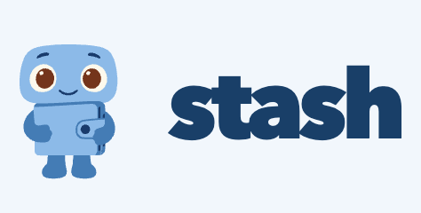

<p align="center">
  
</p>
<p align="center"><strong>A self-hosted credit tracker for AI and cloud services.</strong></p>
<p align="center">
  <a href="#installation">Installation</a> ·
  <a href="#supported-providers">Providers</a> ·
  <a href="#usage">Usage</a> ·
  <a href="docs/technical-guide.md">Documentation</a>
</p>

Stash brings your remaining credits from OpenAI, OpenRouter, Higgsfield, and other providers into one local dashboard. Connect your accounts, check balances, and see which wallets need a top-up.

When every provider has its own wallet and billing page, keeping track means opening each account separately. Stash was built to make that a single check, so a depleted balance does not have to be the first sign that you are running low.

## Features

- **Remaining credits in one place.** Each account shows its balance, last update, and connection status.
- **API and browser connections.** Use a provider key or sign in through a local browser, with no extension required.
- **Manual or scheduled refreshes.** Check one account, refresh all, or choose an interval while Stash is running.
- **Low-balance indicators.** Set a threshold for each account to flag when it needs attention.
- **Free and self-hosted.** MIT-licensed code, local credential storage, and no AI model key required for core tracking.

## Installation

You need **Git, Node.js 22 or later, and npm**. Browser connections also need a desktop session for the first sign-in.

```sh
git clone https://github.com/tbskin/ai-credit-tracker.git
cd ai-credit-tracker
npm ci
npm run browser:install
npm start
```

Open **[localhost:4747](http://localhost:4747)** and click **Add account**.

API-only users can skip `npm run browser:install`. On Linux, use `npx playwright install --with-deps chromium` if browser system dependencies are missing.

**No AI model key, browser extension, or paid browser service is required.** API connections use the provider's key to read your balance. Browser connections use a login session saved on your computer.

## Supported providers

Stash tracks **remaining wallet credits**, keeping each provider and currency separate.

| Provider          | Balance tracked                                          | How you connect                                                      |
| ----------------- | -------------------------------------------------------- | -------------------------------------------------------------------- |
| OpenAI            | Prepaid API balance                                      | Sign in through the local browser                                    |
| OpenRouter        | Purchased credits remaining after usage                  | Management API key                                                   |
| Higgsfield        | API wallet balance                                       | Sign in through the local browser                                    |
| Railway           | Unused wallet credits                                    | Account API token and workspace ID, or an existing Railway CLI login |
| Vercel AI Gateway | Gateway credit balance                                   | AI Gateway API key                                                   |
| Supabase          | Organization credit balance                              | Sign in through the local browser                                    |
| Vercel hosting    | Remaining credits, when the account has a credit balance | Sign in through the local browser                                    |

Spending, monthly budgets, rate limits, and free-tier allowances are different from wallet credits. Stash does not present those numbers as money left to spend. For example, Railway's separate included usage credits are not added to its wallet balance.

## Usage

### 1. Connect an account

Click **Add account** and choose a provider. Only the accounts you add appear on your dashboard. There is currently one connection per provider.

For an **API connection**, enter the requested provider key and account details. Stash fetches the balance directly. The key is not used to run AI models.

For a **browser connection**:

1. Enter the provider's billing page URL and choose the balance unit.
2. Sign in normally in the browser window Stash opens, including any two-factor authentication.
3. Open your billing page and click **Find balance** in Stash. Confirm the suggested amount and account in the browser. If it cannot identify the balance, use **Select manually** to click the number yourself.
4. Click **Done** in Stash. It saves the session and the confirmed balance location for future refreshes.

You do not need to give Stash your password. Browser setup and balance detection work without AI.

### 2. Check your balances

Each account shows its remaining balance, last update, and any connection error. Refresh one account or click **Refresh all**.

Set an optional **Alert threshold** for each account to flag a low balance in the dashboard. This is a visual indicator, not an email or push notification.

### 3. Keep them up to date

Choose a refresh interval, or leave scheduled checks off and refresh manually. **Stash and your computer must stay running for scheduled checks.** You can close the dashboard tab and your everyday browser.

If a refresh fails, Stash keeps the last known balance and shows the error. An expired login needs another sign-in. A changed billing page may need you to find or select the balance again.

## How it works

Stash uses a provider API when a verified balance field is available. For other providers, it runs a local Chromium browser through Playwright and reuses your saved login session. Supabase can also be read from its dashboard's credit-balance response.

Browser automation uses ordinary code. **Scheduled refreshes never call an AI model.** Optional AI help can suggest a balance during setup if you configure your own model key or a local model. It is disabled by default, and you still confirm the result. See [optional AI setup](docs/technical-guide.md#optional-ai-setup).

## Your data stays with your installation

Stash is a single-user local app. It listens on `127.0.0.1` and stores API keys and browser sessions under `.private/app/`, which is excluded from Git. There is no Stash cloud account or analytics service.

API keys are encrypted locally, but the encryption key is stored on the same machine. Treat the data folder as credentials. Disconnecting a provider deletes its saved key, balance, and dedicated browser profile.

A public web deployment and remote browser sign-in are not built in. See [self-hosting and data](docs/technical-guide.md#self-hosting-and-data) for Linux, private servers, storage, and configuration details.

## For developers and AI agents

**Project:** Stash. **Repository:** `ai-credit-tracker`. **Stack:** Node.js, plain JavaScript, and Playwright. No build step is required.

| Task                                    | Command or file                                                                                          |
| --------------------------------------- | -------------------------------------------------------------------------------------------------------- |
| Install dependencies                    | `npm ci`                                                                                                 |
| Install the test and automation browser | `npm run browser:install`                                                                                |
| Start the app                           | `npm start`                                                                                              |
| Run backend and browser tests           | `npm run check`                                                                                          |
| Add or inspect provider API readers     | [`src/providers.js`](src/providers.js)                                                                   |
| Inspect browser sessions and refreshes  | [`src/browser/harness.js`](src/browser/harness.js)                                                       |
| Inspect balance detection and selection | [`src/browser/discovery.js`](src/browser/discovery.js), [`src/browser/reader.js`](src/browser/reader.js) |
| Inspect local routes and scheduling     | [`src/server.js`](src/server.js)                                                                         |
| Edit the dashboard                      | [`public/`](public/)                                                                                     |
| Review connector evidence               | [Provider audit](docs/provider-api-audit.json), [OpenAI audit](docs/openai-api-audit.json)               |

When changing a connector, verify the meaning of its balance field. Preserve the distinction between remaining credits and usage. Keep credentials out of logs, fixtures, screenshots, and commits. Automated tests use synthetic billing pages; passing them does not establish live provider compatibility.

For connection internals, optional AI configuration, migration behavior, and known limitations, read the [technical guide](docs/technical-guide.md).

## License

Stash's code is [MIT-licensed](LICENSE). It is free to run and self-host. Provider credits and any optional hosted AI inference are paid for separately. Logos and trademarks retain their owners' rights; see [asset attribution](docs/assets.txt).
