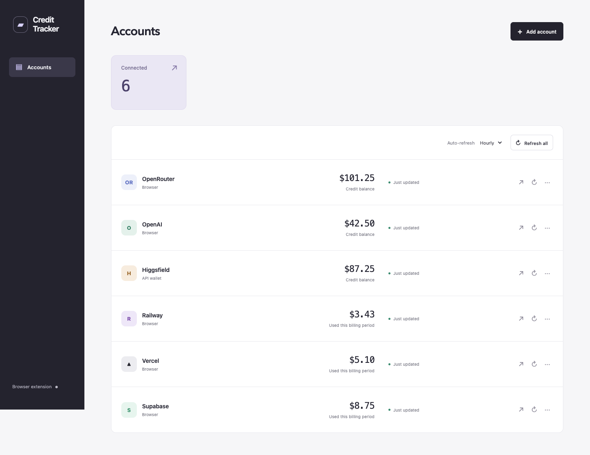

# Credit Tracker

A small, self-hosted dashboard for prepaid AI wallets and cloud usage. Connect OpenRouter, OpenAI, Higgsfield's API wallet, Railway, Vercel, and Supabase. Refresh on demand or on a schedule.



_Screenshot uses synthetic balances from automated tests, not live account data._

## Run locally

Requires **Node.js 22 or newer** and npm.

```sh
npm ci
npm start
```

Open **http://localhost:4747**. No account with Credit Tracker is needed. Choose **Add account**, then select a provider. Only connected providers appear on the dashboard. The server binds only to your computer's loopback interface; this release is a personal, single-user app. Do not expose it to the internet or proxy it without authentication.

## Connections

| Provider   | API connection                                                                | Browser connection                                |
| ---------- | ----------------------------------------------------------------------------- | ------------------------------------------------- |
| OpenRouter | Management key → calculated credit balance                                    | Select remaining wallet balance                   |
| OpenAI     | Organization admin key → calendar-month spend                                 | Select remaining prepaid balance                  |
| Higgsfield | No supported wallet-read endpoint verified                                    | Select the **API console** wallet balance         |
| Railway    | Account token or CLI login + workspace ID → billing-period usage and estimate | Select prepaid balance, allowance, or usage       |
| Vercel     | Access token + team ID → calendar-month billed cost                           | Select remaining credit or usage figure           |
| Supabase   | No full billing-read endpoint verified                                        | Select billing credit, allowance, or usage figure |

The browser connection exists because a generation API key does not necessarily grant access to a wallet balance. It reads a number you explicitly select on the provider's billing page, rather than estimating a balance from spending.

For OpenAI, create an **organization admin key**, not a project generation key. For OpenRouter, use a **management key**. Vercel's token must have billing access for the supplied team. For Railway, use an **account token** (`RAILWAY_API_TOKEN` semantics), not a project deployment token; alternatively install the Railway CLI and run `railway login`. The adapter invokes pinned CLI version 5.63.1 through npx, which may download it on the first run.

### Browser extension setup (Chrome / Chromium)

1. Open `chrome://extensions`, enable **Developer mode**, select **Load unpacked**, and choose the project's `extension` directory.
2. In the dashboard, open **Browser extension**, click **Get pairing code**, and paste it into the extension popup. The code expires in five minutes and works once.
3. Connect a provider using **Browser balance**. Choose what the figure means (wallet balance, spend, or remaining allowance), its currency/unit, and its billing page URL.
4. Sign in to the provider in Chrome. Open its billing page for the account you want to track.
5. Open the extension, select the provider, and click **Select balance on this page**. Approve access to that provider's site.
6. Click the balance number, check the displayed amount and unit, and select **Use this balance**.

Only site access for the selected provider is requested. The extension does not read or transmit cookies, passwords, or API keys. It sends the selected number and its page location/context to the local app. A separate pairing token authorizes these updates and can be revoked from the dashboard.

The initial release supports full numeric amounts such as `$1,234.56`. Select one number, not a whole card with multiple amounts or an abbreviated `1.2k`. Pages inside cross-origin frames or closed shadow roots, alternate number formats, and balances only revealed by interacting with menus may require a different billing page and are not universally supported.

### Refresh behavior

- Default: hourly. Choose 15 minutes, 30 minutes, 3 hours, or off.
- The Node process must remain running for API refreshes, even when the dashboard is closed.
- Browser refresh also requires Chrome and the paired extension. Pending jobs are picked up about every 30 seconds.
- Browser refresh opens the saved billing URL in a background tab and closes that temporary tab afterwards. It never clicks the provider's purchasing or generation controls.
- The selected element must remain visible, unique, and in the same surrounding text context. Login expiry or layout changes produce an error; select the balance again to repair the connection.
- Failed refreshes keep the last successful value, labeled with its timestamp and error. Provider reporting delays still apply.
- Cloud spend is distinct from wallet balance. Each account shows its own reported value and unit; there is no combined wallet total.

## Data and security

Runtime state lives in `.private/app/`, excluded from Git. API credentials and the extension pairing token use AES-256-GCM encryption with a local, file-protected key. Back up the entire directory if you need to preserve connections; losing its key makes encrypted credentials unreadable. This protects against accidentally exposing the state file alone, not an attacker with access to your computer and key file.

The server validates Host and Origin headers, requires a dashboard CSRF token for mutations, and requires a separate bearer token for extension updates. Provider URLs are allowlisted, API redirects are rejected, and provider error bodies are not logged. Disconnect removes the stored credential and current snapshot for that provider.

There is no telemetry, remote analytics, central account, or external font service. Your own providers still receive authenticated read requests and normal browser page loads.

`CREDIT_TRACKER_DATA` can set a different runtime directory. `PORT` can change the web server port for development, but the bundled extension targets port **4747**. Use the default port for browser connections.

## Development and tests

```sh
npm ci
npx playwright install chromium
npm test
npm run test:e2e
npm run dev
```

Tests use synthetic provider responses and isolated temporary data, not your saved accounts. Browser tests load the real extension against six intercepted billing-page fixtures, confirm selected balances, refresh changed values, and verify layout-change failures retain old values. Optional host permissions are pre-granted in the test-only extension copy; Chrome's permission prompt is not automated.

`verify.py` is the original optional, dependency-free Python diagnostic tool. The dashboard does not depend on Python. Its older setup notes are in `README.txt`.

## Limitations and roadmap

- One connection per provider; multiple organizations/accounts are planned.
- Browser access is a selectable-page connector, not a vendor-supported balance API. It can break when sites change. Real-account verification is needed for each provider's specific billing page.
- No historical charts, top-up automation, email alerts, public hosting, or multi-user authentication in this release.
- API and browser modes currently replace each other for a provider. Tracking wallet balance and API spend simultaneously is planned.

## Provider documentation

- [OpenRouter credits](https://openrouter.ai/docs/api/api-reference/credits/get-remaining-credits)
- [OpenAI costs](https://developers.openai.com/api/reference/resources/admin/subresources/organization/subresources/usage/methods/costs)
- [Railway usage](https://docs.railway.com/cli/usage)
- [Vercel billing charges](https://vercel.com/docs/rest-api/billing/list-focus-billing-charges)
- [Higgsfield API documentation](https://docs.higgsfield.ai/docs)
- [Supabase Management API](https://supabase.com/docs/reference/api/introduction)

## License

[MIT](LICENSE). You may use, modify, and redistribute this project under its license. This project is independent of the listed providers.
